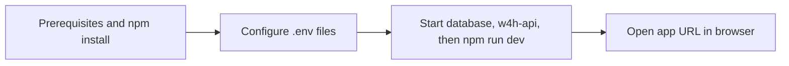

# w4h-app

This README is a **user-facing** guide: run the app locally and use it in the browser.

**Developers:** stack overview, local workflow, Vite / Playwright / ESLint → **[DEVELOPMENT.md](DEVELOPMENT.md)**.

---

## Account setup

Short guide to set-up and start **w4h-app**. It has **two parts**: **(1) installing and starting the app on your computer** when you run W4H locally, and **(2) signing in and using the app in the browser**.

---

## Part 1 — Run W4H on your computer (local setup)

### Install prerequisites

These are the pieces of **software** you should **download and install** (or already have) **before** you rely on the app working in the browser. They do **not** all need to be **running** at the same time until you reach **Step 3** (start the stack).

| What | Version / notes |
|------|-----------------|
| **Node.js** | Required range is in **`package.json`** → **`engines`** → **`node`**: **`^20.19.0` or `>=22.12.0`**. 
| **PostgreSQL** | A version compatible with **w4h-api** — installed locally, run via **Docker**, or **hosted** somewhere your computer can reach. The **API** connects to it. |
| **w4h-app** and **w4h-api** | Source code **cloned** (or copied) on your machine.|

### Steps (typical order)

These steps assume you **already have the code** — you **cloned** **w4h-app** and **w4h-api** (or a **combined package**) onto your computer. 

| Step | What you do |
|------|-------------|
| **1. Install project dependencies** | With **Node.js** installed (see **Install prerequisites** above), open a terminal in the **w4h-app** folder and run **`npm install`** — this **downloads JavaScript dependencies** into `node_modules`.|
| **2. Configure environment** | In **w4h-app**, copy **`.env.example`** to **`.env`** and set **`VITE_API_URL`** to your API’s base URL (for a local API, often something like `http://localhost:PORT` where `PORT` matches **w4h-api**). Configure **w4h-api** `.env` and database connection per **w4h-api** README. | 
| **3. Start the stack** | Start **PostgreSQL** if it runs on your machine. Start **w4h-api**. In **w4h-app**, run **`npm run dev`**. Wait until the terminal shows the app is ready. | 
| **4. Open the app** | In your browser, open the **URL** printed in the terminal (often **`http://localhost:5173`** for Vite). You should see the W4H **login** screen. | 

### First time on a new machine

The first time this environment runs, the app may show **database connection** or **first administrator** screens **before** normal sign-in. Your team or IT should tell you what to enter (or whether everyone uses a **shared** database URL so data is not only on your laptop).

### A quick diagram

---

## Part 2 — Using W4H in the browser

### Sign in (two ways)

**1. Email + password** — On the main login page, enter **email** and **password**, then **Sign in**.

**2. Email code** — Use **“Login with email code”**, enter your **email**, request the code, then enter the **verification code** from your email.

---

### Right after sign-in (sometimes)

If a **“Set your password”** screen appears on the home page, your account required a new password. Enter and confirm a password that meets the **Password rules** section below, then continue.

---

### Password rules

Whenever the app asks you to create or change a password, it must:

- Be **at least 12 characters**
- Include **uppercase**, **lowercase**, a **number**, and a **special character**

(Same rules apply on the first-admin screen, admin-created accounts, profile updates, and the “set password” screen after login when it appears.)

---

### After you’re signed in

- **Home** — Starting screen that includes **cards** (tiles) you can open for **Studies**, **Analytics**, and **Docs**, plus anything else your team adds. See the next section for what each is meant for.
- **Projects** (in the top menu): a list of **projects / studies** you’re associated with. You see names and identifiers your administrator assigned.
- **Help** — Opens **documentation** (same content family as the **Docs** card when it points to help topics).
- **Account** — Open your user menu (your name) → **Account settings** to change **name** and **password** (same password rules as above).

From the menu you can also **Sign out**. If you see **Admin settings**, your account has an **administrator** role and can manage users, projects, and system settings—your team should tell you what you’re allowed to change.

---

## Home page cards — Studies, Analytics, and Docs

On **Home**, you may see cards for **Studies**, **Analytics**, and **Docs**. 

| Card | What it’s for |
|------|----------------|
| **Studies** | **Data** are organized as **collections of datasets** (studies / projects). Use this path to browse what you have access to. |
| **Analytics** | **Insights** on **wearables** and other **study data**—explore and interpret data connected to your projects. |
| **Docs** | **Guides and reference material** for using the **W4H Toolkit**—how to use features, workflows, and concepts. |
